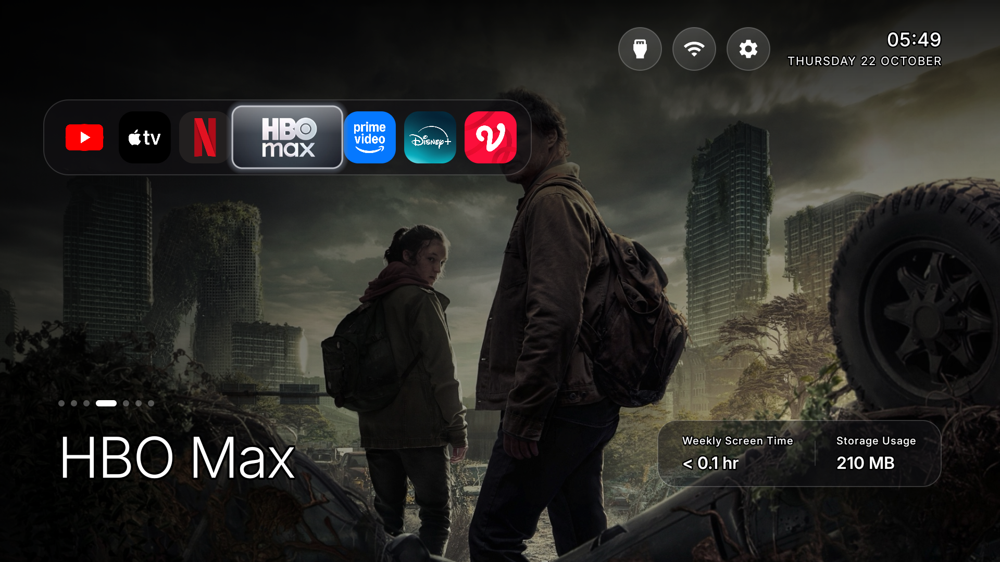
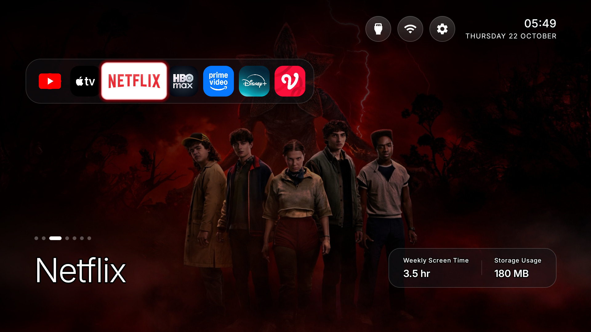
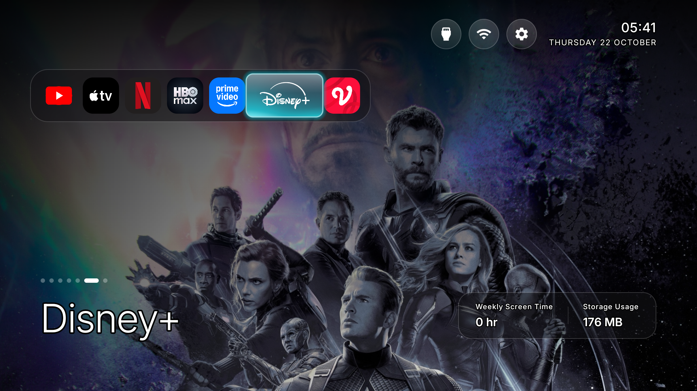
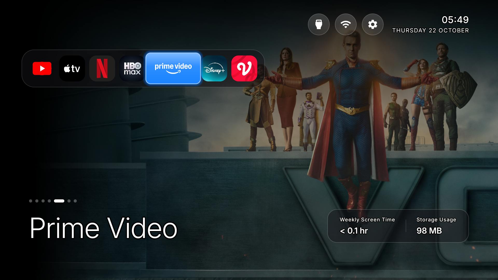

<p align="center">
  <a href="https://cleanyour.tv"></a>
</p>

# Custom by Ilham Asyari

## How it works

Android TVs have the same debug bridge as Android phones. Switch on USB debugging in the TV's
developer options, allow your computer once, and the rest is standard Android tooling:

1. **Back up** the list of installed packages and settings.
2. **Disable** the manufacturer's telemetry, ad services, content rows and preloaded junk with
   `pm disable-user`. Nothing is uninstalled, so a restore script can undo every step.
3. **Install** a small native launcher and make it the default home screen.

**No root, no cable, nothing uninstalled, and a one-line restore if you change your mind.**

The bloat differs by brand, so the prompt has your coding assistant discover it on your TV and ask
before touching anything you might use.

| | |
|---|---|
| **1. On the TV** | Settings → Device Preferences → About → press OK on **Build** seven times → back → Developer options → **USB debugging** on. If you see a Network or ADB debugging toggle, turn that on too. Keep the TV on. |
| **2. On your computer** | Paste [`PROMPT.md`](PROMPT.md) into your assistant and fill in your TV model. |
| **3. Follow along** | Accept "Allow USB debugging?" on the TV, then answer the checklist: which apps you use, which four go in the dock, whether to keep the voice assistant, Chromecast and updates. |

> [!TIP]
> **PS5 Launcher & Single-Prompt Customization**: To replicate this custom Apple TV 4K style launcher with custom dock apps, show wallpapers, Ken Burns effect, and stats using a single prompt or interactive wizard, check out **[REPLICATE_LAUNCHER.md](REPLICATE_LAUNCHER.md)**.

## Tutorials and Frequently Asked

This edition customizes CleanYourTV with an Apple TV 4K style bottom dock, hardware-accelerated Ken Burns show wallpapers, an ambient photo screensaver, and an interactive installer.

### 1. 🖼️ How to Add Custom Wallpapers
Each dock app displays a full-bleed 1080p cinematic backdrop that cross-fades and slowly zooms/drifts (Ken Burns effect) when focused:

1. **Get your 1080p backdrops**: Choose 1920×1080 JPEG images for your streaming apps (e.g. key art from Netflix, YouTube, HBO Max, etc.).
2. **Place images in the project**:
   - Put the files into `launcher/app/src/main/res/drawable-nodpi/` (e.g., `wallpaper_netflix.jpg`, `wallpaper_youtube.jpg`, `wallpaper_prime.jpg`).
   - Also save a copy in `wallpapers/` for easy reference.
3. **Map the package**:
   In [`launcher/app/src/main/java/com/gathin/tvhome/MainActivity.java`](launcher/app/src/main/java/com/gathin/tvhome/MainActivity.java), link the package name to the drawable:
   ```java
   DOCK_WALLPAPERS.put("com.netflix.ninja", R.drawable.wallpaper_netflix);
   ```
4. **Compile into APK**:
   When you build with `./install.sh` or `./gradlew assembleDebug`, all wallpapers are **baked directly inside `app-deblouting-ps5.apk`**. No internet connection or external storage is required on the TV to display wallpapers!

---

### 2. 📸 How to Add Screensaver Photos
The screensaver displays a smooth, non-burning photo slideshow with original aspect ratio preservation (portrait photos get subtle blurred ambient borders, landscape photos fit full screen):

1. **Place your photos**: Drop any personal photos (Apple `.HEIC`, `.JPG`, `.PNG`, `.WEBP`) into the `screensaver/` folder.
   > [!NOTE]
   > **Privacy Guarantee**: The `screensaver/` folder is strictly in `.gitignore`. Your personal photos will **never** be committed to Git or uploaded to GitHub.
2. **Sync to TV**:
   - **Automatic**: When running `./install.sh`, it will detect the folder and ask:
     ```
     Detected photos in screensaver/ folder. Sync screensaver photos to TV (/sdcard/Screensaver/)? (Y/n)
     ```
   - **Standalone Script**: You can also run `./tools/sync-screensaver.sh` anytime. It converts HEIC to baseline JPEG, optimizes dimensions to 1080p (reducing size by ~85% to prevent TV RAM crashes), and uploads them to `/sdcard/Screensaver/`.
   - **USB Method (Zero PC)**: You can copy photos to a USB flash drive and paste them into `/sdcard/Screensaver/` on your TV using any TV file manager (e.g. X-plore).

---

### 3. 📱 Handling "Outside" Apps & Missing Default Apps

#### What if a default dock app is NOT installed on the TV?
*(e.g. HBO Max is listed in the dock, but the TV doesn't have it installed)*
- **100% Safe & Zero Crashes**: The launcher checks Android's `PackageManager` first. Any uninstalled app is simply skipped.
- **Auto-Fill Option**: If `<bool name="fill_dock">true</bool>` is enabled in [config.xml](launcher/app/src/main/res/values/config.xml), any empty slot is automatically filled by other installed apps so there is never an awkward gap.
- **Play Store Detection**: If the user installs the missing app later from Google Play Store, the launcher detects it and places it on the dock automatically.

#### How to access apps outside the dock?
*(e.g. Spotify, Kodi, VLC, Plex, or games not pinned to the dock)*
- **Option A (Add to Dock)**: Edit `dock_apps` and `columns` in [config.xml](launcher/app/src/main/res/values/config.xml). The dock supports any number of apps.
- **Option B (App Grid Below Dock)**: Set `<integer name="rows_below_dock">1</integer>` (or 2) in [config.xml](launcher/app/src/main/res/values/config.xml). Pressing **DOWN** on the remote scrolls into a grid of all your other apps.
- **Option C (Top "App" Tab)**: Set `topTabs` visibility to `visible` in [activity_main.xml](launcher/app/src/main/res/layout/activity_main.xml) to get an Apple TV-style top tab bar with a dedicated full-screen App Library.
- **Option D (Top Settings Icon)**: Click the **Settings ⚙️** icon on the top bar -> **Apps** -> **See all apps** to launch any installed app.

---

### 4. ⚡ 1-Click Install & Safe Rollback

- **Install**: Run `./install.sh` in your terminal. It guides you through connecting to your TV IP, installs `app-deblouting-ps5.apk`, and sets up permissions.
- **Rollback**: Run `./uninstall.sh` to safely restore your factory stock launcher (Google TV / Android TV) in 15 seconds. Or simply uninstall CleanYourTV from TV **Settings ⚙️** -> **Apps** -> **CleanYourTV** -> **Uninstall**.

The assistant backs up, debloats, builds and installs the launcher, and checks each step with
screenshots pulled from the TV. With this repo as context it takes about fifteen minutes.

## What you get

- **A pitch-black home** with a dock of your four favourite apps in a rounded band, where Apple TV puts it.
- **A top shelf** naming the focused app in large type, with an ambient glow in a colour taken from its artwork.
- **The rest of your apps in a grid** that slides up when you press Down.
- **One floating glass highlight** that springs from tile to tile. The focused tile lifts and shows its name.
- **Three frosted buttons**: Inputs (HDMI ports under the names you gave them in the TV's settings, AV, Live TV), Wi-Fi or Ethernet with the network name, Settings.
- **A greeting, a thin clock and the date** in [Outfit](https://fonts.google.com/specimen/Outfit), and a matching Clock screensaver. Set `show_stats` in config or a theme for one line under the clock: CPU, free memory and free storage. It stays off unless you turn it on, and it refreshes only while Home is on screen.
- **Themes** that change colours, wallpaper, dock and columns without a rebuild, and **module cards** that let other apps plug a tile in, only with your say-so.

And a TV that stops working against you: no sponsored rows, no "Discover" nags, no analytics
phoning home, no apps you never asked for.

| | |
|---|---|
|  |  |
|  |  |

## Supported TVs

Anything running **Android TV** or **Google TV**. Samsung (Tizen) and LG (webOS) run different
systems; see [SHOWCASE.md](SHOWCASE.md) for a webOS port, and
[docs/devices/samsung-tizen.md](docs/devices/samsung-tizen.md) for what a 2021 Samsung set answers
over Wi-Fi (no ADB, so no `pm disable-user`) if you are weighing a Tizen port. **Fire TV** takes the
debloat half only, since Fire OS will not hand Home to a third-party launcher - and on the 2015 Fire
TV Box (Fire OS 5) even that half fails: every `pm` route is refused, so nothing can be disabled
there at all. A few China-market TCL
sets refuse to install any launcher at all; their lists say so in the header.
